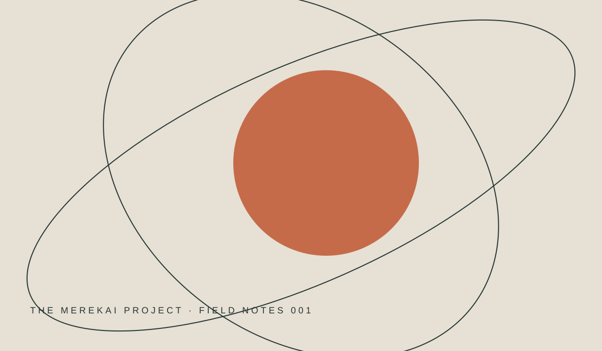

<p align="center">
  
</p>

<p align="center">
  <strong>A thoughtful corner of the web</strong><br>
  Ideas, technology, culture and tradition — to explore at your own pace.
</p>

<p align="center">
  <a href="https://merekai.es"><strong>EXPLORE MEREKAI&nbsp; ↗</strong></a>
  &nbsp;&nbsp;|&nbsp;&nbsp;
  <a href="https://github.com/ogrgijon/ogrgijon.github.io">Browse the source</a>
</p>

<p align="center">
  <a href="https://merekai.es">
    
  </a>
</p>

> **Just here to read?** You don't need to install or download anything. The website is ready to explore at **[merekai.es](https://merekai.es)**. This GitHub page is the workshop behind it; the link above takes you to the live site.

---

## A few paths to follow

<table>
  <tr>
    <td align="center" width="50%">
      <a href="https://merekai.es/journal/"></a><br>
      <strong><a href="https://merekai.es/journal/">THE JOURNAL</a></strong><br>
      Essays on technology, culture and a changing world.
    </td>
    <td align="center" width="50%">
      <a href="https://merekai.es/projects/"></a><br>
      <strong><a href="https://merekai.es/projects/">PROJECTS</a></strong><br>
      Experiments, initiatives and things made with purpose.
    </td>
  </tr>
  <tr>
    <td align="center" width="50%">
      <a href="https://merekai.es/reading/"></a><br>
      <strong><a href="https://merekai.es/reading/">THE READING ROOM</a></strong><br>
      A quiet place for longer ideas and reflection.
    </td>
    <td align="center" width="50%">
      <a href="https://merekai.es/es/tradition/"></a><br>
      <strong><a href="https://merekai.es/es/tradition/">TRADITION</a></strong><br>
      Spanish stories and customs rooted in place.
    </td>
  </tr>
</table>

Merekai is a bilingual editorial and project website, designed to be calm, readable and welcoming on both desktop and mobile. It includes a language switcher, responsive navigation, an RSS feed and a sitemap. Its Gijón information panel uses local tide and solunar data rather than making browser requests to external services.

<p align="center"><a href="https://merekai.es/about/"><strong>More about the project →</strong></a></p>

## Curious about how it works?

This repository contains the source code and content used to build the website. It is for people who want to learn how the site is made, run it on their computer, contribute or publish new content. If you simply want to visit, head to **[merekai.es](https://merekai.es)**.

### Built with

Merekai is a static website built with [Jekyll](https://jekyllrb.com/), Liquid templates, Markdown and custom CSS. Journal entries and project pages are maintained as content files, while shared layouts and includes keep the experience consistent. GitHub Actions can build and deploy the site to GitHub Pages.

### Run locally

Install Ruby and Bundler, then from the repository directory run:

```bash
bundle install
bundle exec jekyll serve
```

Open `http://127.0.0.1:4000/`. The site is configured for the custom domain, so `baseurl` is empty.

## Publish with GitHub Pages

1. Push the repository to GitHub.
2. In the repository's **Settings → Pages**, choose **GitHub Actions** as the deployment source.
3. Confirm that `merekai.es` is listed as the custom domain and that its DNS records point to GitHub Pages.
4. Push to `main` and follow the build and deployment workflow in the **Actions** tab.

The included workflow is `.github/workflows/pages.yml`.

## Publishing content

### Journal articles

Add a Markdown file to `_posts/` using Jekyll's date-based filename format, for example `2026-10-21-a-title-worth-reading.md`:

```yaml
---
title: "A title worth reading"
subtitle: "A useful subtitle"
date: 2026-10-21
category: TECHNOLOGY
description: "A short summary for search and sharing."
image: /assets/images/editorial-abstract.svg
image_alt: "Describe the image"
---
```

Write the article after the front matter. Store image files in `assets/images/`. English and Spanish articles are separate posts; set `lang: es` and `translation_url` on Spanish posts to connect them with their English counterparts.

### Projects

Create a Markdown file in `_projects/`, for example `_projects/my-project.md`:

```yaml
---
title: "My project"
date: 2026-10-21
status: "IN PROGRESS"
description: "One-sentence explanation of the project."
---
```

Add the project content below the front matter. The collection publishes project pages under `/projects/`.

### Reading Room articles

Create a Markdown page under `reading/` and set `layout: page`, `reading_room: true` and `reading_article: true` in its front matter. Include the page's `lang`, `translation_url`, `permalink`, `title`, `kicker` and `description` so it appears correctly in navigation and metadata.

The shared design system in `assets/css/reading-room.css` provides responsive typography, comfortable reading measure, heading hierarchy, quotation, list, link and print styles. Optional editorial elements include `.reading-byline`, `.reading-toc`, `.reading-callout`, `.reading-pullquote`, `.reading-figure` and `.reading-sources`.

### Tradition articles and local Gijón data

Spanish tradition articles live in `tradition/`. Set `tradition_article: true`, a `recurring_month` from 1 to 12, `tradition_theme`, `description` and `permalink` in the front matter. The tradition index groups entries by recurring month, including articles from previous years.

The calendar's lunar-phase and tropical solar-sign markers are approximate cultural orientation, not a precision ephemeris. The Gijón panel reads archived XML from `assets/data/` and does not fetch external data in the browser. Tide predictions in `gijon-tides.xml` are for IHM port 6 (43.558333, -5.698333); `gijon-solunar.xml` contains locally calculated events. After updating the tide data, regenerate the solunar file with:

```bash
node scripts/generate-gijon-solunar.js
```

The local ephemeris is indicative only; it is not a guarantee of fish activity or a substitute for official nautical predictions.

## Before launch

- The canonical URL is `https://merekai.es`; `_config.yml` uses an empty `baseurl` for the custom domain.
- Replace sample content and update `about.md` with accurate project and contact information.
- The footer contact address is `info@ogrgijon.es`.
- Add only verifiable metrics; the site intentionally avoids invented statistics.
- If adding analytics, a newsletter or forms, consider applicable privacy and consent requirements.

## License

No license is currently specified. Contact the project owner before reusing this repository's content or assets.
